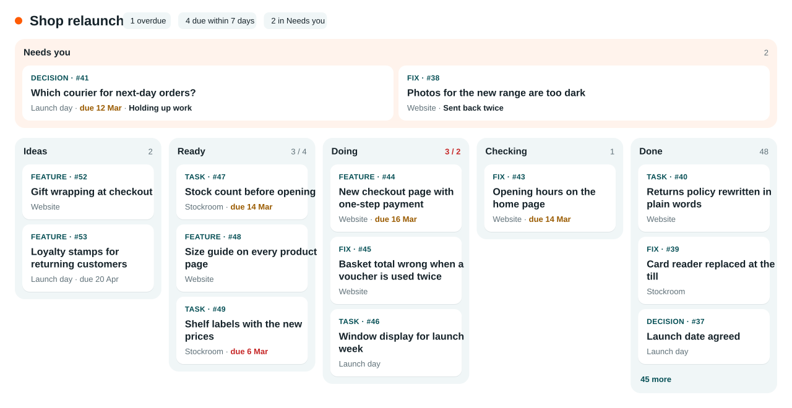

# Board Extractor

A small part a program fits inside itself to show its cards with the [Board Generator](https://github.com/chalouhi/board-generator). Hand it a settings file and your card records; it writes the board file (every card, reduced) and the card file (one card, in full), checked and ready to draw. For anyone whose program keeps work as cards.



## Two ways to use it

1. **Inside a Python program** (Python 3.10 or later, nothing else; one install step):
   ```bash
   pip install "git+https://github.com/chalouhi/board-extractor@v1.0.0"
   ```
   ```python
   from board_extractor import board_file, card_file
   board = board_file(settings, records, today="2026-03-10", group="Website")
   card = card_file(settings, record)
   ```
   A wrong input raises one `ExtractorError` holding every problem in plain words.
2. **The command**, for any other program, script or person (no network):
   ```bash
   board-extractor samples/shop/settings.json samples/shop/records.json --today 2026-03-10 --out board.json
   ```
   On a wrong input it writes nothing, prints every problem, and ends with exit code 1.

To try the whole chain on one machine, start the **example board**, `python3 example/serve.py`, and open <http://127.0.0.1:8400/>.

## Learn more

- **[Using the Board Extractor](docs/guide.md)**: the part, the command and the example in full, what each file holds, how it behaves, its limits.
- **[The input](docs/input-format.md)**: how to write the settings and the card records.
- **[Release notes](docs/release-notes.md)**.

## What is in this repository

| Folder | |
|---|---|
| `board_extractor/` | The part, and the command (`python3 -m board_extractor`). |
| `bin/` | The command, from a copy with no install step. |
| `example/` | The example board: a tiny service, its database, its page. |
| `docs/` | The user guide and the input guide. |
| `samples/`, `expected/` | Sample inputs and the files they must give. |
| `vendor/` | The Board Generator 1.1, unchanged, with its licence. |
| `tests/` | `python3 -m unittest discover -s tests` and `node --test tests/*.test.js`; no network. |

MIT licence. Repository: [github.com/chalouhi/board-extractor](https://github.com/chalouhi/board-extractor).
